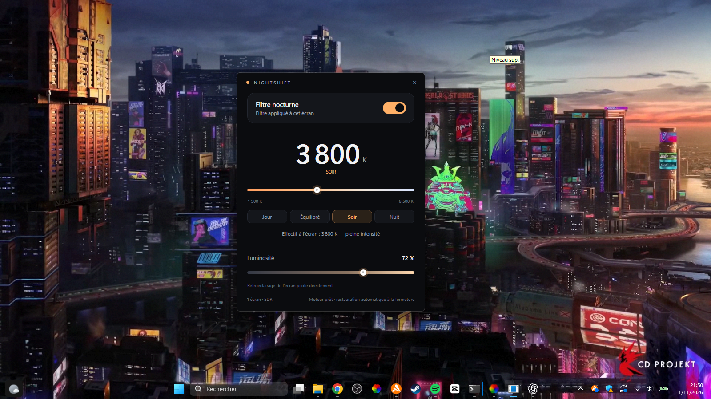

# NIGHTSHIFT

Un écran plus chaud. Des soirées plus douces.

NIGHTSHIFT est une petite application Windows 11 qui ajuste la température de couleur de l’écran. Elle applique des tables gamma par écran et affiche la température et l’intensité réellement obtenues, qui peuvent différer de la consigne selon les limites de Windows et du moniteur.

[English](README.md) · [Français](README.fr.md)



## Fonctionnalités

- Réglage de 1 900 K à 6 500 K, avec les préréglages Jour, Équilibré, Soir et Nuit.
- Filtre couleur appliqué par écran via les tables gamma de Windows.
- Affichage de la température effective et de l’intensité réellement appliquée.
- Réglage matériel de la luminosité lorsque l’écran le permet.
- Restauration de la table gamma précédente à la fermeture de l’application.
- Application locale, sans compte ni connexion réseau nécessaire.

Windows peut limiter les tables gamma trop éloignées du réglage neutre. NIGHTSHIFT indique l’intensité obtenue au lieu de laisser croire que chaque consigne est appliquée intégralement.

## Télécharger

La dernière version Windows se trouve dans les [Releases](https://github.com/galasim94-byte/NIGHTSHIFTS/releases/tag/v0.1.0-preview.1). La version actuelle nécessite le **.NET 8 Desktop Runtime**.

## Compiler les sources

Prérequis : Windows 11 et le SDK .NET 8.

```powershell
git clone https://github.com/galasim94-byte/NIGHTSHIFTS.git
cd NIGHTSHIFTS
dotnet build NIGHTSHIFT.sln -c Release
dotnet run --project src/UI/Nightshift.UI.csproj -c Release
```

## État du projet

Le filtre couleur, le moteur d’affichage et l’interface WPF sont implémentés. La planification, les profils enregistrés et le gardien permanent dans la zone de notification sont prévus pour la suite. Consulte le dossier [`documentation/`](documentation/) pour les choix techniques et mesures réalisées.

## Contributions

Les signalements de bugs et suggestions sont bienvenus dans [GitHub Issues](https://github.com/galasim94-byte/NIGHTSHIFTS/issues). Pour un problème lié à un écran, indique la version de Windows ainsi que les températures demandée et effective.

## Licence

Aucune licence n’a encore été choisie. Contacte le propriétaire du dépôt avant de réutiliser ou redistribuer le code.

