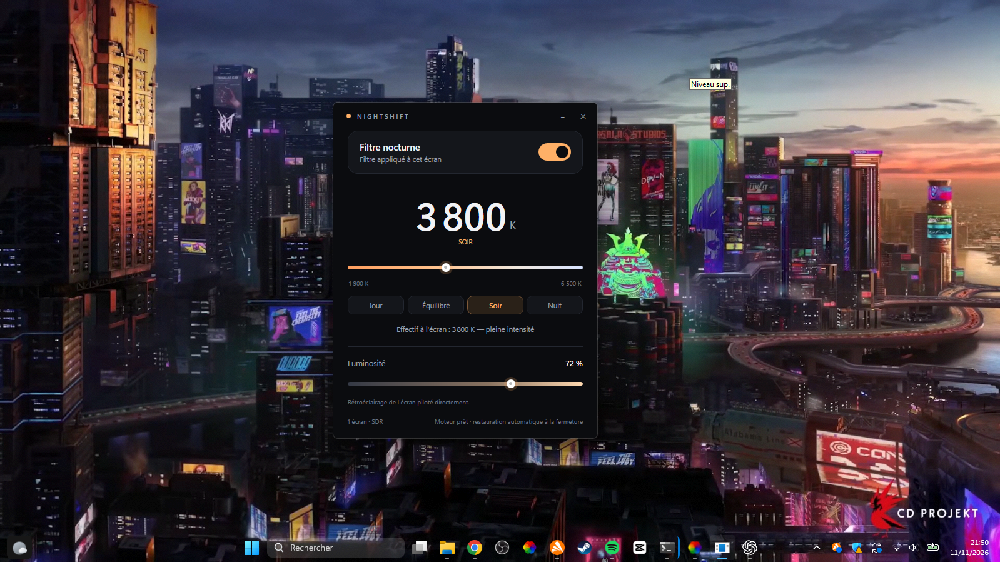

# NIGHTSHIFT

A warmer screen. A calmer night.

NIGHTSHIFT is a small Windows 11 desktop app for adjusting screen color temperature. It applies per-display gamma ramps and reports the temperature and intensity Windows actually allows, which can differ from the requested setting on some displays.

[English](README.md) · [Français](README.fr.md)



## Features

- Color temperature control from 1,900 K to 6,500 K, with Day, Balanced, Evening, and Night presets.
- Per-display color filtering through Windows gamma ramps.
- An on-screen estimate of the effective color temperature and applied intensity.
- Hardware brightness control where the monitor supports it.
- Restores the previous display ramp when the app closes.
- Local desktop app; no account or network connection is required.

Windows may limit gamma tables that are far from neutral. NIGHTSHIFT shows the resulting intensity rather than pretending every requested value can be applied in full.

## Download

Get the latest Windows build from [Releases](https://github.com/galasim94-byte/NIGHTSHIFTS/releases/tag/v0.1.0-preview.1). The current build requires the **.NET 8 Desktop Runtime**.

## Build from source

Requirements: Windows 11 and the .NET 8 SDK.

```powershell
git clone https://github.com/galasim94-byte/NIGHTSHIFTS.git
cd NIGHTSHIFTS
dotnet build NIGHTSHIFT.sln -c Release
dotnet run --project src/UI/Nightshift.UI.csproj -c Release
```

## Project status

The color filter, display engine, and WPF interface are implemented. Scheduling, saved profiles, and a persistent tray guardian are planned work. See [`documentation/`](documentation/) for design notes and measured display behavior.

## Contributing

Bug reports and suggestions are welcome through [GitHub Issues](https://github.com/galasim94-byte/NIGHTSHIFTS/issues). Please include your Windows version, display type, and the requested and effective temperature when reporting a display-specific issue.

## License

A license has not yet been selected. See the repository owner before reusing or redistributing the code.

